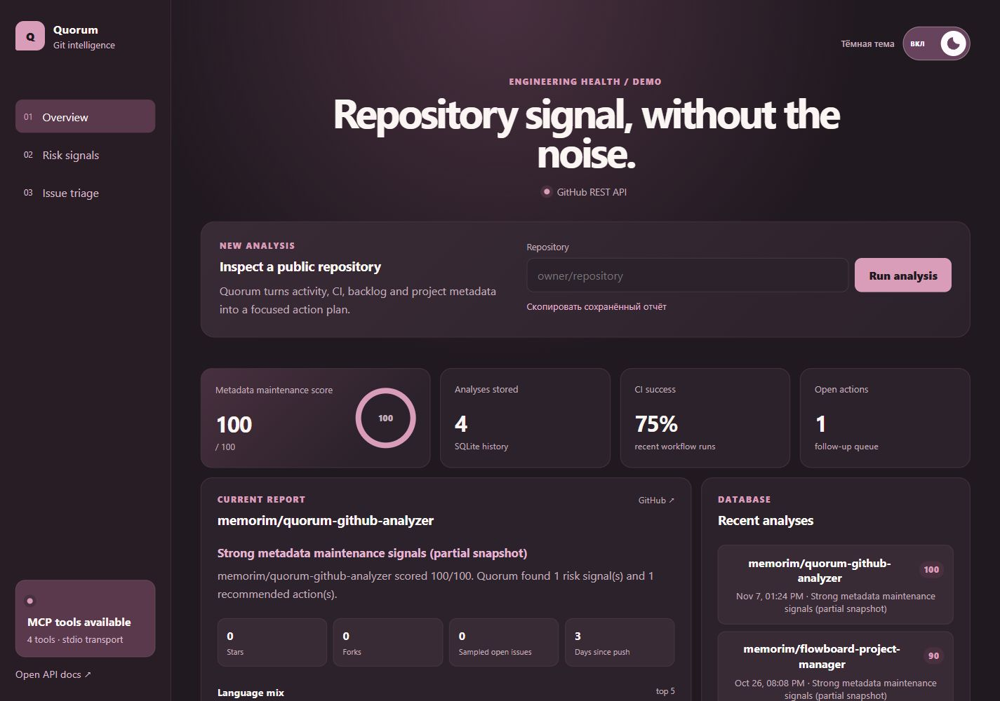
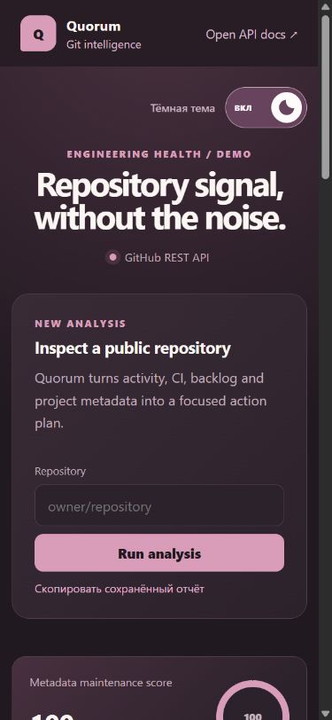

# Quorum - анализ метаданных GitHub

Повторяемый отчёт о сопровождении репозитория по открытым метаданным GitHub.

[Открыть проект](https://memorim.github.io/quorum-github-analyzer/) · [Серверная версия](https://memorim-quorum.onrender.com)





## Возможности

- Загрузка сведений о репозитории, issues, pull requests и запусках workflows.
- Хранение отчётов и приоритизация работ по сопровождению.
- Адаптивная панель, REST API и MCP-инструменты.
- Светлая палитра с бордовым боковым меню. Кнопка Dark mode переключает тему и сохраняет выбор в этом браузере.

## Стек и устройство

Python, FastAPI, HTTPX, SQLite или PostgreSQL, GitHub REST API и MCP.

## Ключевые решения

- Клиент фиксированного api.github.com отделён от правил оценки и заменяется заглушкой в тестах.
- Ссылки на репозитории валидируются, выборки ограничены. Оценки - детерминированные эвристики метаданных, без проверки корректности исходного кода.
- Пагинация ограничена тремя страницами issues (по 50, включая PR в исходном ответе) и двумя страницами PR (по 50); CI использует окно из 20 запусков. `metrics.collection` показывает недоступность и обрезку выборок. Это наблюдаемый снимок, а не точный глобальный счётчик.
- Ошибки GitHub не подменяются отсутствием CI. Повреждённый JSON и недопустимая структура возвращают безопасную ошибку или явно неполный результат. Перенаправления и произвольные URL из Link не выполняются.
- REST и MCP используют общую валидацию репозитория и задач; SQLite-соединения закрываются после операции. Обзор считает все записи, независимо от размера списка.

## Локальный запуск

Python 3.12.14, как в `.python-version`. Перед установкой зависимостей активируйте виртуальное окружение.

```bash
python -m venv .venv
# Windows: .venv\Scripts\activate
# Linux/macOS: source .venv/bin/activate
python -m pip install -c requirements-lock.txt -e ".[dev]"
uvicorn app.main:app --host 127.0.0.1 --port 8010
```

Команда запуска привязывает API к локальному адресу 127.0.0.1.

## Настройки

Доступные параметры перечислены в [.env.example](.env.example). Секреты храните вне Git. Порядок загрузки настроек и необязательные службы описаны в [технической документации](docs/TECHNICAL.md).

## Данные и обновления

Схема SQLite создаётся при запуске. Пути к базе и снимкам настраиваются; постоянные данные должны находиться вне временных каталогов сборки.

## Проверки

```bash
python -m pytest -q
python tests/check_contract.py
python tests/check_upgrade.py
python -m pip check
python -m ruff check .
node --test tests/frontend.test.cjs
```

Pytest проверяет HTTP 401/403/404/429/500, таймауты, JSON, пагинацию, частичные ответы и настоящий MCP stdio-сеанс без внешних запросов. Отдельный тест на Node.js 24 проверяет экранирование заголовков и безопасные ссылки панели. Ruff, OpenAPI и обновление предыдущей схемы также входят в CI.

CI устанавливает зависимости по зафиксированным версиям и запускает настроенные проверки. Отдельная проверка документации находит неверные локальные ссылки и изображения. Проверка уязвимостей учитывает известные проблемы на момент запуска.

## Область анализа и эксплуатация

- Отчёт не является аудитом безопасности или доказательством качества эксплуатации. На наблюдения влияют права токена, лимиты API и обрезанные выборки.
- Ошибки необязательных API сохраняются в `metrics.collection`; частичные результаты отмечаются в выводе. Отсутствующая дата push остаётся неизвестной. Повторный анализ создаёт новый снимок истории, а не обновляет прежний; повторная команда создания задачи создаёт отдельную запись.
- Транспортные ошибки и временные ошибки GitHub повторяются ограниченно; при длительном rate limit нужно дождаться восстановления лимита. Таймаут одного запроса - 15 секунд. Переименованный репозиторий с HTTP redirect требует ввода нового owner/name. Исторические отчёты не пересчитываются автоматически.
- Локальный режим и MCP stdio сохраняются. Для публичного REST добавлены индивидуальные ключи пользователей, проверка HTTPS origin и изоляция истории в PostgreSQL или отдельных SQLite-файлах. [Настройка пользователей и размещения](docs/PUBLIC_ACCESS.md). Токены GitHub хранятся вне репозитория и не наследуются публичными пользователями от локального оператора.
- Issue titles и прочий текст GitHub недоверенны: панель экранирует их, MCP возвращает их как данные. Инструменты не исполняют команды из репозитория; смысловая безопасность последующего MCP-хоста зависит от его собственных правил.

## Документация

[Результаты аудита](docs/AUDIT_2026_10.md) · [Техническая документация](docs/TECHNICAL.md) · [Пример запроса и ответа](docs/API_EXAMPLE.md) · [История изменений](CHANGELOG.md)

## Версия в браузере

Открывается без установки и обращается к открытым данным GitHub из браузера. История отчётов сохраняется на этом устройстве; серверные гарантии SQLite и MCP относятся к отдельному локальному запуску, описанному выше.

Сборка: `python scripts/build_demo.py`. Проверка адаптера: `node --test demo/demo.test.mjs`.

В опубликованной версии можно анализировать новые публичные репозитории: запросы идут напрямую к GitHub API без приватного токена. История последних 100 отчётов сохраняется в localStorage этого браузера. Одновременные запросы одного репозитория объединяются; отчёт младше минуты используется повторно. Приватные репозитории требуют серверного запуска.
