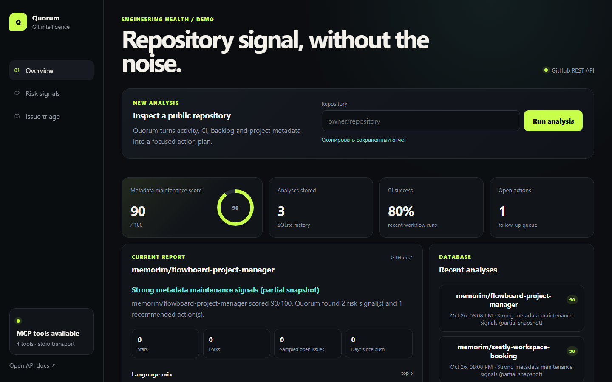
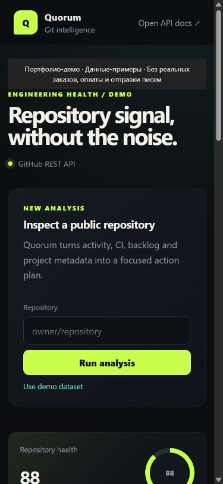

# Quorum — анализ GitHub-репозиториев

Собирает открытые метаданные репозитория и формирует отчёт о состоянии.

**Проект:** Самостоятельная разработка.






[Короткая демонстрация сценария](docs/demo.gif)

## Что работает
- Получение метаданных GitHub, история отчётов и список рекомендуемых действий.
- Детерминированная оценка состояния и приоритизация открытых issues.
- Адаптивная панель, REST и MCP-инструменты.

## Стек
Python, FastAPI, HTTPX, SQLite, GitHub REST API, MCP.

## Запуск и проверка
Python 3.12.14.

```bash
python -m venv .venv
# Windows: .venv\Scripts\activate
# Linux/macOS: source .venv/bin/activate
python -m pip install -c requirements-lock.txt -e ".[dev]"
python -m ruff check .
python -m pytest -q
uvicorn app.main:app --host 127.0.0.1 --port 8010
```

## Технические решения
- GitHub-клиент отделён от анализа и подменяется в тестах.
- Проверка оценки тестового репозитория не зависит от старения фиксированной даты fixture.

## Подробности
[API, конфигурация и исходные инструкции](docs/TECHNICAL.md).

[Результаты проверки этой версии](docs/VERIFICATION.md).

[Пример запроса и ответа API](docs/API_EXAMPLE.md).

## Проверки и обновления
CI проверяет проект и ссылки на локальные материалы. Dependabot предлагает обновления зависимостей и Actions. [История изменений](CHANGELOG.md).

[Контракты API и обновление базы](docs/COMPATIBILITY.md): `python tests/check_contract.py && python tests/check_upgrade.py`.
